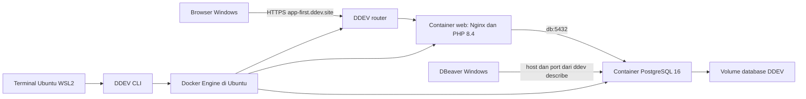

# Rencana implementasi DDEV: Laravel, Filament, dan PostgreSQL

Tanggal: 18 November 2026  
Status project: **diterapkan dan terverifikasi di Ubuntu WSL2**  
Environment terverifikasi: **DDEV di Ubuntu WSL2 dengan Docker Engine di Ubuntu**  
Source Windows saat ini: `C:\project\Laravel13\app-first`  
Lokasi kerja aktif: `~/projects/app-first` di filesystem Ubuntu

Project Laravel dan panel Filament berjalan melalui DDEV. Bagian 1–11 mendokumentasikan analisis awal dan langkah untuk mengulangi setup. Hasil aktual implementasi tercatat di bagian 12. Untuk penggunaan harian, lihat [panduan setup](SETUP.md).

## 1. Tujuan dan kondisi project

Target akhirnya adalah membuka Laravel dan Filament melalui `https://app-first.ddev.site/admin`, dengan PHP, Composer, dan PostgreSQL berjalan di container DDEV.

Hasil pemeriksaan environment dan repository.

| Komponen | Kondisi saat ini | Rencana |
| --- | --- | --- |
| Laravel | `13.42.0` pada `composer.lock` | Pertahankan versi terkunci |
| Filament | `5.11.4`, panel `/admin` sudah tersedia | Gunakan instalasi yang ada |
| Livewire | `4.4.8` | Pertahankan versi terkunci |
| PHP | Windows CLI `8.4.4`. Project mensyaratkan `^8.3` dan `ext-pdo_pgsql` | PHP `8.4` di container, periksa patch dan ekstensi setelah startup |
| Composer | Windows `2.10.2` | Composer `2` di container, instal dari `composer.lock` |
| PostgreSQL | Service `postgresql-x64-16` aktif di Windows. `127.0.0.1:5432` menerima koneksi. Database sumber `filament` memiliki empat migration berstatus `Ran` | PostgreSQL `16` milik DDEV dengan database `db` |
| Aset admin | Aset bawaan Filament tersedia dari paket Composer | Terbitkan melalui `filament:upgrade` |
| Otorisasi | `User::canAccessPanel()` memerlukan `is_admin=true` | Pertahankan |
| WSL | WSL `2.7.12.0`. Distro `Ubuntu` aktif dan terdaftar sebagai WSL versi `2` | Jalankan CLI DDEV dan simpan salinan kerja di Ubuntu |
| DDEV | `v1.25.5` di `/usr/bin/ddev`. `ddev list` belum menampilkan project | Daftarkan project `app-first` saat implementasi |
| Docker di Ubuntu | Docker Engine Community `29.10.0` untuk client dan server, Docker Compose `v5.7.1`, service `docker` aktif, konteks `default` menjalankan `unix:///var/run/docker.sock` | Gunakan daemon Ubuntu dari terminal yang sama |
| Docker Desktop | Versi launcher terpasang `4.88.1.237512`. Distro `docker-desktop` berstatus `Stopped` saat diperiksa | Daemon yang tersedia untuk alur ini adalah Docker Engine di Ubuntu |
| Konfigurasi container project | Tidak ditemukan `.ddev`, `Dockerfile`, atau file Docker Compose pada project | Buat `.ddev/config.yaml` di salinan Ubuntu |

Struktur yang dipakai adalah `artisan` dan `composer.lock` di root, `public/index.php` sebagai pintu masuk web, `config/database.php` dan `.env` untuk koneksi database, serta `database/migrations/` untuk skema. `bootstrap/providers.php` mendaftarkan `AdminPanelProvider` yang menyediakan `/admin`. Gunakan `composer install` untuk mempertahankan versi Laravel, Filament, dan Livewire yang terkunci. Panel menggunakan aset bawaannya.

## 2. Mode terpilih: DDEV di WSL2 Ubuntu

Gunakan terminal **Ubuntu** tempat DDEV sudah terpasang. Semua command `ddev` dalam dokumen ini dijalankan dari Ubuntu.

| Komponen | Peran dalam setup ini |
| --- | --- |
| WSL2 Ubuntu | Menyediakan terminal dan filesystem Linux untuk CLI DDEV serta source project |
| Docker Engine | Menjalankan container dan menyimpan volume PostgreSQL. Pada mesin ini, daemon aktif di Ubuntu |
| DDEV | Membaca `.ddev/config.yaml`, menghasilkan dan menjalankan konfigurasi Compose, serta mengelola container web, database, dan router |
| Docker Desktop | Dapat menyediakan Docker Engine melalui integrasi WSL. Mesin ini sudah menjalankan Docker Engine langsung di Ubuntu dengan Docker Desktop berhenti |

Gunakan `ddev config`, `ddev start`, `ddev describe`, dan `ddev stop` untuk mengelola project. DDEV menangani pembuatan dan eksekusi file Compose. [Cara kerja DDEV](https://docs.ddev.com/en/stable/users/usage/architecture/).

Lokasi kerja aktif yang direncanakan adalah `~/projects/app-first`, misalnya `/home/candr/projects/app-first`. Folder Windows terlihat dari Ubuntu sebagai `/mnt/c/project/Laravel13/app-first` dan digunakan sebagai sumber penyalinan awal. Simpan project aktif di filesystem Linux sesuai [panduan workflow WSL2 DDEV](https://docs.ddev.com/en/stable/users/install/ddev-installation/#step-3-start-working-in-wsl2).

Ulangi pemeriksaan berikut di **Ubuntu** sebelum mulai jika kondisi mesin berubah. Perintah `wsl --list --verbose` tersedia dari PowerShell untuk memeriksa versi distro.

```bash
ddev version
systemctl is-active docker
docker context show
docker version
docker compose version
ddev list
```

Jika `ddev` tidak ditemukan di Ubuntu, periksa PATH atau distro tempat DDEV dipasang. Tidak ditemukannya executable pada PowerShell tidak menentukan ketersediaan DDEV di Ubuntu.

Penyalinan project dilakukan pada tahap A setelah backup. Source Windows tetap disimpan. Setelah beralih, lakukan perubahan aplikasi pada salinan Ubuntu agar tidak terbentuk dua salinan kerja yang berbeda. Editor Windows dapat membuka folder melalui `\\wsl.localhost\Ubuntu\home\candr\projects\app-first`; sesuaikan nama distro dan user jika berbeda.

Jika browser Windows belum mempercayai HTTPS DDEV, periksa konfigurasi sertifikat WSL/Windows dari panduan instalasi tersebut sebelum menguji login.

## 3. Rancangan runtime dan koneksi



Untuk mengurangi konfigurasi khusus, database container menggunakan default DDEV: nama database `db`, username `db`, password `db`, dan hostname internal `db`. Ini adalah kredensial development DDEV, terpisah dari akun login Filament. [Default database DDEV](https://docs.ddev.com/en/stable/users/usage/database-management/#database-backends-and-defaults).

| Akses | Host | Port | Database / akun |
| --- | --- | --- | --- |
| Browser ke router DDEV | `app-first.ddev.site` | `80` HTTP dan `443` HTTPS secara default | URL admin memakai HTTPS |
| Laravel di container ke PostgreSQL | `db` | `5432` | `db` / `db` |
| DBeaver ke PostgreSQL DDEV | Host dari `ddev describe` | Port host dari `ddev describe` | `db` / `db` |
| PostgreSQL Windows yang lama | `127.0.0.1` | `5432` | `filament` / `admin` |
| Login Filament | `https://app-first.ddev.site/admin` | HTTPS | User dari tabel `users` |

Nama `filament` pada database lama tidak harus sama dengan nama database tujuan. Dump PostgreSQL tanpa `--create` dapat diimpor ke database DDEV `db`.

## 4. Tahap A: backup sebelum mengubah environment

Jalur utama mempertahankan data project yang sudah dibuat, termasuk admin pertama. Migration membuat atau mengubah schema; migration tidak memindahkan data dari PostgreSQL Windows ke container.

Sebelum ekspor, hentikan aktivitas tulis aplikasi dan worker pada database sumber agar salinan data konsisten dengan file upload yang disalin. Database sumber tetap dipertahankan.

### A1. Backup database sumber di Windows

Karena sumber database masih PostgreSQL Windows, hanya langkah ekspor berikut yang dijalankan melalui **PowerShell Windows**, sebelum `.env` salinan kerja diubah. Command DDEV tetap dijalankan dari Ubuntu.

```powershell
cd C:\project\Laravel13\app-first
$backupDir = 'C:\project-backups\app-first\2026-11-18'
if (Test-Path -LiteralPath $backupDir) {
    throw 'Pilih direktori backup baru agar backup lama tetap tersimpan.'
}
New-Item -ItemType Directory -Path $backupDir -ErrorAction Stop
Copy-Item -LiteralPath .env -Destination (Join-Path $backupDir '.env.native') -ErrorAction Stop

$dumpFile = Join-Path $backupDir 'filament.sql'
& 'C:\Program Files\PostgreSQL\16\bin\pg_dump.exe' --host=127.0.0.1 --port=5432 --username=admin --password --dbname=filament --format=plain --no-owner --no-acl --file $dumpFile
if ($LASTEXITCODE -ne 0 -or -not (Test-Path -LiteralPath $dumpFile -PathType Leaf) -or (Get-Item -LiteralPath $dumpFile).Length -eq 0) {
    throw 'Backup PostgreSQL gagal atau dump kosong. Periksa hasil pg_dump sebelum melanjutkan.'
}
```

Masukkan password database sumber saat diminta. Jika memakai direktori backup yang berbeda, sesuaikan path dump pada langkah verifikasi dan impor di Ubuntu. Catat jumlah user, status migration, serta jumlah baris tabel bisnis yang perlu dibandingkan setelah impor. Pertahankan `APP_KEY` yang sama ketika membawa data terenkripsi ke environment baru.

Dump tidak menggunakan `--clean` atau `--create`. Backup disimpan di luar repository. Dari Ubuntu, file tersebut dibaca melalui `/mnt/c/project-backups/app-first/2026-11-18/filament.sql`. Ekspor dari Windows ini juga menghindari kebutuhan menghubungkan client Linux langsung ke PostgreSQL Windows.

### A2. Salin source ke filesystem Ubuntu

Setelah aktivitas tulis dihentikan dan backup selesai, jalankan di **terminal Ubuntu**. Command ini menyalin file aplikasi, `.env`, file upload, metadata Git, dan perubahan lokal yang belum di-commit. Dependency Composer dan cache PHP yang dihasilkan di Windows tidak ikut disalin.

```bash
(
    set -eu
    command -v rsync
    test -d /mnt/c/project/Laravel13/app-first

    # Berhenti jika tujuan sudah ada agar tidak menimpa salinan kerja lain.
    if [ -e ~/projects/app-first ]; then
        echo 'Tujuan ~/projects/app-first sudah ada. Periksa isinya sebelum melanjutkan.'
        exit 1
    fi

    mkdir -p ~/projects/app-first
    rsync -a --no-owner --no-group \
        --exclude='/vendor/' \
        --exclude='/bootstrap/cache/*.php' \
        --exclude='/storage/framework/views/*.php' \
        /mnt/c/project/Laravel13/app-first/ ~/projects/app-first/
)
```

Jika `rsync` belum tersedia, pasang paket tersebut di Ubuntu terlebih dahulu dengan `sudo apt-get install rsync`. Jika direktori sumber tidak ditemukan atau penyalinan gagal, perbaiki penyebabnya sebelum melanjutkan. Jika tujuan sudah ada, bandingkan isinya secara manual; jangan mengulangi penyalinan secara membabi buta.

Verifikasi salinan sebelum menjalankan konfigurasi DDEV:

```bash
cd ~/projects/app-first
pwd
test -f artisan
test -f composer.json
test -f composer.lock
test -f .env
git status --short
ls -lh /mnt/c/project-backups/app-first/2026-11-18/filament.sql
```

File dan folder tersembunyi ikut disalin oleh `rsync`; jangan mengganti langkah ini dengan penyalinan wildcard `*` yang melewatkan `.env` dan `.git`. Source di Windows tidak dihapus. Instal dependency Composer kembali melalui container pada tahap C.

Untuk instalasi yang memang ingin memakai database kosong, tahap impor boleh dilewati secara sengaja; admin harus dibuat pada database container. Database Windows lama tetap tidak dihapus.

## 5. Tahap B: siapkan konfigurasi DDEV

Buat konfigurasi pada root project di **Ubuntu**, ketika implementasi dimulai:

```bash
cd ~/projects/app-first
ddev config --project-name=app-first --project-type=laravel --docroot=public --php-version=8.4 --database=postgres:16
```

Periksa `.ddev/config.yaml` **sebelum `ddev start` pertama**. Konfigurasi yang dituju:

```yaml
name: app-first
type: laravel
docroot: public
php_version: "8.4"
webserver_type: nginx-fpm
database:
  type: postgres
  version: "16"
composer_version: "2"
disable_settings_management: true
```

`public` menjadi document root Laravel. PostgreSQL dipilih secara eksplisit karena default DDEV bukan PostgreSQL. [Quickstart Laravel](https://docs.ddev.com/en/stable/users/quickstart/#laravel), [pilihan database](https://docs.ddev.com/en/stable/users/extend/database-types/).

Gunakan `disable_settings_management: true` agar `.env` dikelola secara eksplisit. Pertahankan port router default `80` dan `443` selama tersedia. Jika bentrok, periksa layanan yang memakai port tersebut dan sesuaikan port router DDEV bila diperlukan. Gunakan URL HTTPS aktual dari `ddev describe` untuk `APP_URL`, termasuk port alternatif bila ditampilkan. [Opsi konfigurasi DDEV](https://docs.ddev.com/en/stable/users/configuration/config/).

Biarkan DDEV memilih port database host agar PostgreSQL Windows tetap dapat menggunakan `5432`. Jika perlu port DBeaver yang tetap, tambahkan `host_db_port` yang tersedia ke `.ddev/config.local.yaml`. Laravel di dalam container selalu menggunakan `db:5432` pada konfigurasi ini.

## 6. Tahap C: sesuaikan `.env` untuk container

Ubah `.env` di **`~/projects/app-first/.env`**, setelah backup dan penyalinan selesai. `.env` pada source Windows dipertahankan untuk runtime native. Pengaturan yang dituju:

```dotenv
APP_ENV=local
APP_DEBUG=true
APP_URL=https://app-first.ddev.site

DB_CONNECTION=pgsql
DB_HOST=db
DB_PORT=5432
DB_DATABASE=db
DB_USERNAME=db
DB_PASSWORD=db

SESSION_DRIVER=database
SESSION_DOMAIN=null
SESSION_SECURE_COOKIE=true
CACHE_STORE=database
QUEUE_CONNECTION=database
```

Pertahankan `APP_KEY` yang sudah ada. Jika `DB_URL` aktif pada environment, kosongkan/hapus override tersebut agar tidak mengalahkan pengaturan koneksi di atas. Jangan memakai `127.0.0.1` sebagai `DB_HOST` aplikasi container karena alamat itu menunjuk ke container web sendiri.

Untuk checkout baru, salin `.env.example` hanya ketika `.env` belum tersedia. Sesuaikan `.env.example` agar menjadi template DDEV dengan `APP_KEY` kosong; nilai default development `db` tidak menggunakan password database Windows.

Mulai container dan instal dependency terkunci:

```bash
ddev start
ddev describe
ddev composer install
ddev artisan config:clear
ddev exec php -v
ddev composer --version
ddev exec php -m
ddev composer check-platform-reqs
```

Periksa `pdo_pgsql`, `intl`, `mbstring`, `dom`, `fileinfo`, dan `zip` di PHP container. Jika ada ekstensi yang kurang, perbaiki image web DDEV; `php.ini` Windows tidak mengatur PHP di container. Jangan melewati pemeriksaan dengan `--ignore-platform-reqs`.

Untuk instalasi baru dengan `APP_KEY` kosong saja:

```bash
ddev artisan key:generate
```

Jangan menjalankan `composer setup` yang ada secara langsung untuk transisi ini karena script tersebut juga menjalankan `key:generate` dan migration tanpa membedakan database baru dengan database hasil impor.

## 7. Tahap D: impor data, lalu jalankan migration tertunda

Sebelum impor, pastikan target yang aktif benar:

```bash
ddev psql -c "SELECT current_database(), current_user;"
ddev psql -c "SELECT count(*) AS public_tables FROM information_schema.tables WHERE table_schema = 'public' AND table_type = 'BASE TABLE';"
```

Target impor yang diharapkan adalah database `db` dengan `public_tables = 0`. Jika sudah berisi tabel atau data, hentikan jalur impor dan evaluasi isinya. Simpan backup target sebelum merencanakan pemindahan atau penggabungan data lebih lanjut.

Untuk target kosong, impor backup sumber dengan opsi tanpa drop:

```bash
ddev import-db --no-drop --file=/mnt/c/project-backups/app-first/2026-11-18/filament.sql
```

Opsi `--no-drop` mempertahankan database tujuan. Gunakan dump tanpa perintah pembersihan, dan arahkan impor hanya ke target kosong yang sudah diperiksa. Jika impor gagal sebagian, periksa error dan kondisi target sebelum mencoba lagi. [Referensi import-db](https://docs.ddev.com/en/stable/users/usage/commands/#import-db).

Konfirmasi koneksi dan status migration melalui Laravel.

```bash
ddev artisan db:show --database=pgsql
ddev artisan migrate:status
```

Pastikan `db:show` menampilkan PostgreSQL dengan database `db` dan host `db`. Pada hasil impor, bandingkan status migration serta jumlah baris dengan catatan sumber sebelum masuk ke tahap penerapan. Jika ada migration tertunda dan tabel `migrations` tersedia, tinjau SQL terlebih dahulu.

```bash
ddev artisan migrate --pretend
```

Untuk jalur database kosong, `migrate:status` awal bisa melaporkan tabel `migrations` belum ada. Tinjau metode `up()` di empat file sebelum menerapkannya. Laravel dapat membuat tabel `migrations` saat menjalankan `--pretend` pada database yang belum diinisialisasi.

Setelah target dan perubahan yang tertunda diperiksa, jalankan migration dan verifikasi hasilnya.

```bash
ddev artisan migrate
ddev artisan migrate:status
ddev psql -c "SELECT count(*) AS users, count(*) FILTER (WHERE is_admin) AS admins FROM public.users;"
```

Setelah `migrate`, keempat migration project harus berstatus `Ran`. Laravel hanya menjalankan migration yang belum tercatat di target. Harapkan sembilan tabel untuk skema dasar, termasuk tabel `migrations`.

Bandingkan jumlah data dengan sumber, termasuk user dan status admin. Jangan menjalankan `migrate:fresh`, `migrate:refresh`, `db:wipe`, `ddev delete`, opsi reset database, atau penghapusan Docker volume dalam alur setup ini.

## 8. Tahap E: admin Filament dan aset

Jika admin berhasil terbawa saat impor, gunakan akun tersebut tanpa membuat ulang atau mengganti passwordnya. Jika database container baru dan admin belum ada:

```bash
ddev artisan make:filament-user --panel=admin
ddev artisan app:grant-admin admin@gmail.com
```

Command pertama meminta nama, email, dan password; command kedua memberikan `is_admin=true` pada user yang sudah dibuat. Untuk admin dengan email berbeda, sesuaikan argumennya. Otorisasi, cast password `hashed`, dan guard `web` yang ada tetap digunakan.

Hook Composer project sudah menjalankan `filament:upgrade` untuk menerbitkan aset. Jika perlu verifikasi ulang:

```bash
ddev artisan route:list --path=admin
ddev artisan filament:upgrade
ddev artisan storage:link
```

`storage:link` hanya diperlukan jika link public storage belum benar; periksa link yang mungkin berasal dari Windows sebelum membuatnya di Linux container. File upload pada salinan Ubuntu harus tetap tersedia; jika `public/storage` berupa direktori berisi file, amankan isinya sebelum memperbaiki link tersebut.

Panel `/admin` menggunakan CSS dan JavaScript bawaan Filament yang diterbitkan melalui Composer hook `filament:upgrade`. Langkah penerbitan aset tersebut menjadi bagian setup panel ini.

## 9. DBeaver dan penggunaan harian

Jalankan `ddev describe` dari `~/projects/app-first` di **Ubuntu**, lalu buat koneksi PostgreSQL baru pada **DBeaver Windows** bernama misalnya `app-first DDEV WSL`. Gunakan host dan port eksternal yang ditampilkan, database `db`, username `db`, password `db`. Biarkan koneksi PostgreSQL Windows lama memiliki nama berbeda. Periksa `Schemas > public > Tables` setelah **Test Connection** berhasil. [Database GUI DDEV](https://docs.ddev.com/en/stable/users/usage/database-management/#database-guis).

Hostname internal `db` dipakai oleh aplikasi container. Untuk DBeaver Windows, gunakan alamat akses host yang ditampilkan, biasanya `127.0.0.1` dengan port publikasi database DDEV. Port publikasi otomatis dapat berubah setelah `ddev stop` dan `ddev start`. Jika koneksi Windows gagal sementara `ddev psql` di Ubuntu berhasil, cek kembali port lalu uji dengan `Test-NetConnection -ComputerName 127.0.0.1 -Port <port-DDEV>` di PowerShell setelah mengganti placeholder dengan angka. Port `5432` Windows memakai PostgreSQL sumber.

Di SQL Editor DBeaver, pastikan koneksi DDEV menampilkan database `db`, empat migration pada skema saat ini, dan kolom `is_admin` pada tabel `users`. Query berikut juga memberi angka pembanding terhadap database sumber.

```sql
SELECT current_database(), current_user;
SELECT migration, batch FROM public.migrations ORDER BY id;
SELECT count(*) AS users, count(*) FILTER (WHERE is_admin) AS admins
FROM public.users;
```

Pada navigator `Schemas > public > Tables`, periksa `users`, `password_reset_tokens`, `sessions`, `cache`, `cache_locks`, `jobs`, `job_batches`, `failed_jobs`, dan `migrations`.

Workflow harian dijalankan dari **terminal Ubuntu**, setelah `cd ~/projects/app-first`:

| Kebutuhan | Command |
| --- | --- |
| Mulai aplikasi | `ddev start` |
| Buka admin | `ddev launch /admin` |
| Artisan | `ddev artisan ...` |
| Composer | `ddev composer ...` |
| Worker saat dibutuhkan | `ddev artisan queue:work --tries=1` pada terminal terpisah |
| Log web / database | `ddev logs -s web` / `ddev logs -s db` |
| Berhenti | `ddev stop` |

Nginx dan PHP-FPM DDEV melayani aplikasi; tidak perlu `php artisan serve` atau `composer dev` yang menjalankan server PHP native. Startup awal tidak diberi hook otomatis untuk migration, import database, atau pembuatan admin. Command operasional DDEV tersedia pada [referensi CLI](https://docs.ddev.com/en/stable/users/usage/commands/).

## 10. File yang direncanakan berubah saat implementasi

| File | Rencana perubahan |
| --- | --- |
| `.ddev/config.yaml` | Tambah runtime Laravel, PHP 8.4, dan PostgreSQL 16 pada salinan project Ubuntu |
| `.ddev/.gitignore` | Dihasilkan oleh DDEV untuk file lokal dan file hasil generate |
| `.ddev/config.local.yaml` | Opsional, port database host tetap atau preferensi mesin; tidak masuk Git |
| `.env` | Ubah `.env` salinan Ubuntu ke database container, pertahankan `APP_KEY`; tidak masuk Git |
| `.env.example` | Template onboarding DDEV |
| `README.md`, `docs/SETUP.md` | Jadikan DDEV alur utama; tandai panduan native sebagai referensi lama |
| `composer.json` | Tinjau workflow `setup`/`dev`; sesuaikan hanya jika dibutuhkan untuk onboarding DDEV |

Panel Filament, User, command `app:grant-admin`, migration lama, dan test yang ada tidak memerlukan perubahan perilaku untuk berpindah runtime. File dependency PHP tetap dipasang dari lockfile tanpa pembaruan versi paket sebagai bagian setup ini.

## 11. Verifikasi dan kriteria selesai

Jalankan setelah target database siap:

```bash
ddev composer validate --strict
ddev composer check-platform-reqs
ddev composer test
ddev composer test:postgres
ddev exec php vendor/laravel/pint/builds/pint --test
ddev composer audit
ddev artisan migrate:status
```

Suite utama project memaksa SQLite `:memory:`. Suite PostgreSQL menggunakan koneksi `.env` dan transaksi rollback; periksa implementasinya tetap tidak menjalankan reset database sebelum digunakan. Hasil test native terdahulu bukan bukti test di container; hasil DDEV harus dicatat ulang.

Checklist penerimaan:

- [x] DDEV dan Docker dapat dijalankan dari Ubuntu WSL2.
- [x] Salinan kerja aktif berada di `~/projects/app-first` dengan perubahan lokal dan direktori penyimpanan yang disalin.
- [x] PHP, Composer, dan ekstensi container memenuhi dependency.
- [x] Laravel terhubung ke PostgreSQL container di `db:5432`.
- [x] Impor ke database kosong mempertahankan akun admin dan catatan migration.
- [x] Keempat migration berstatus `Ran` di database DDEV dan database sumber Windows masih dapat diakses.
- [x] `https://app-first.ddev.site/admin/login` terbuka dari Windows dan sertifikatnya valid.
- [x] Admin berhasil login, dashboard tampil, dan aset CSS/JS berhasil dimuat.
- [x] Tes mencakup penolakan user biasa, password salah, dan logout.
- [x] Sembilan tabel dan akun admin dapat dibaca dari Windows lewat host dan port untuk DBeaver.
- [x] Tes utama, integrasi PostgreSQL, dan pemeriksaan dependency lulus.
- [x] `ddev stop` lalu `ddev start` mempertahankan data dan akses admin.
- [x] Dokumentasi akhir memuat file yang berubah dan hasil verifikasi.

Jika perlu kembali ke runtime Windows, jalankan `ddev stop` dari Ubuntu, lalu buka source Windows yang tetap menyimpan konfigurasi native dan database lamanya. Periksa `.env` Windows, gunakan backup bila diperlukan, lalu bersihkan config cache menggunakan PHP native. Perubahan source dan data baru pada salinan Ubuntu tidak otomatis tersalin kembali ke Windows; sinkronisasi source serta ekspor dan rekonsiliasi data diperlukan sebelum berganti salinan kerja.

## 12. Hasil implementasi

- DDEV `1.25.5` berjalan di Ubuntu dengan Docker Engine `29.10.0`, Nginx, PHP `8.4.27`, Composer `2.11.2`, dan PostgreSQL `16.16`. `composer install` memakai lockfile yang sama dengan source Windows.
- Backup PostgreSQL dan `.env` native disimpan di `%LOCALAPPDATA%\AppFirst\Backups\pre-ddev-20261118-131326-a0aa0365`. Database Windows `filament` tetap menyimpan satu akun admin dan empat catatan migration. `.env` Windows identik dengan backup.
- PostgreSQL DDEV memakai `db:5432`. Impor dijalankan ke target kosong menggunakan `--no-drop` dan menghasilkan sembilan tabel. `ddev artisan migrate` melaporkan `Nothing to migrate` karena keempat migration sudah tercatat dalam dump.
- Admin yang diimpor berhasil login dari Windows di <https://app-first.ddev.site/admin>. Dashboard dan 11 aset Filament/Livewire merespons HTTP 200. Router menggunakan CA mkcert Windows yang sudah dipercaya melalui symlink direktori mkcert Ubuntu.
- `composer test` lulus 13 tes dan 69 assertion. `composer test:postgres` lulus 11 tes dan 45 assertion. Composer validation, platform requirements, Pint, dan audit dependency juga lulus.
- Koneksi PostgreSQL dari Windows terverifikasi lewat `127.0.0.1:22519`, dengan database, username, dan password development masing-masing `db`. Port tersebut berlaku saat verifikasi dan dapat berubah setelah restart. Gunakan `ddev describe` untuk nilai terkini. Pemeriksaan dilakukan lewat `psql` Windows dengan parameter yang sama untuk DBeaver.
- File dalam repository yang diperbarui untuk setup ini meliputi `.ddev/config.yaml`, `.env.example`, `README.md`, `docs/SETUP.md`, dan dokumen ini. `.env` di salinan Ubuntu berisi koneksi DDEV dan mempertahankan `APP_KEY` dari sumber. DDEV menghasilkan file runtime di `.ddev` pada salinan Ubuntu.
